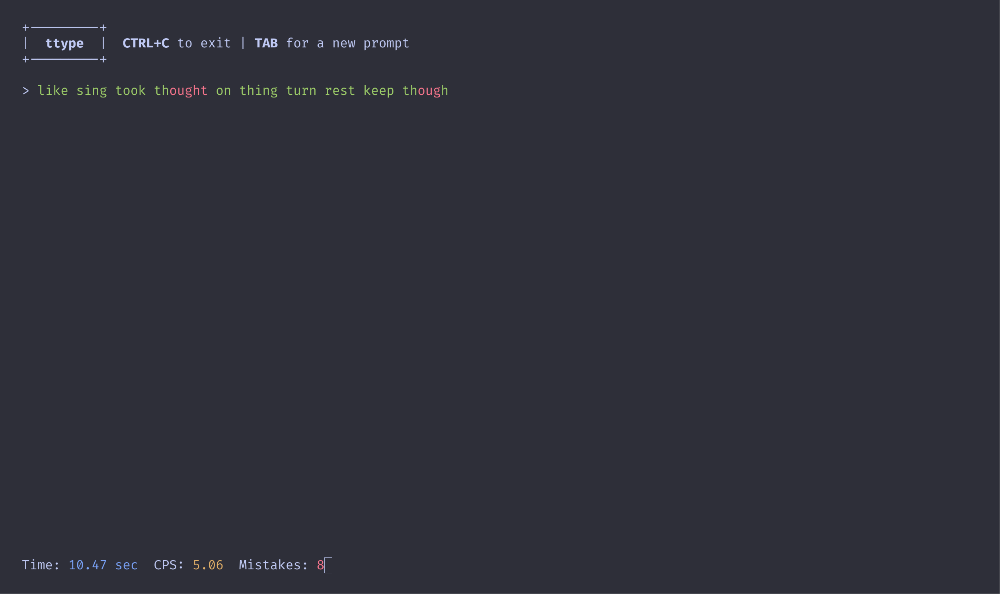

# ttype



**ttype** is a small, ncurses-based typing test application. This is by no means
fully featured, and exists mostly because typing acts as a "digital fidget toy"
for me.

Being able to pull up a small terminal based typing test is quite fun!

## Installation

You should be able to install on Linux, MacOS, BSD, or any other POSIX or
POSIX-like system. The following dependencies are required to install:

- `gcc`/`clang` - If using `clang` you'll need to tweak the `Makefile`
- `make`
- `ncurses`
- `glibc`/`musl libc` - Already installed in 98% of systems :)

Most of these should be available natively via packages managers, or should
generally be installed already.

Once you've installed the dependencies you can clone this repo with git and
install with make:

```bash
git clone https://github.com/aaatipamula/ttype.git

cd ttype && make install
```

Install will place the resulting binary at `~/.local/bin/ttype` meaning no
super user privileges are required to install! This does however mean that you
should put `~/.local/bin` on your `PATH`.

In your `.zshrc` or `.bashrc` file add the following if it doesn't exist already.

```bash
export PATH="$PATH:$HOME/.local/bin"
```

## Usage

Just run `ttype`.

By default it will give you 10 words, you can specify the number of words you
want with the `-n` option.

```bash
ttype -n 23
```

A word bank is stored at `~/.config/ttype/workbank.txt`. If you would like to
add or remove words you can do it there. Alternatively you can specify your own
word bank with the `-w` option.

```bash
ttype -w ./mywords.txt
```

When you've completed your test, you can hit `ENTER` or `CTRL+C` to close the
program.
